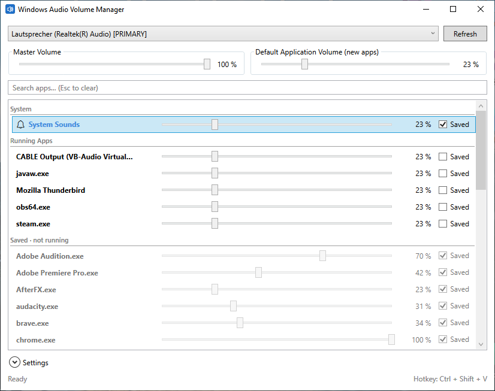

# Windows Audio Volume Manager
A better volume mixer for Windows.

Press **Ctrl+Shift+V** (configurable) to open the GUI, or double-click the tray icon.

## Screenshot

## Requirements
- Windows 10/11 with the [.NET 10 Desktop Runtime](https://dotnet.microsoft.com/download/dotnet/10.0)

## Features
- Set master volume
- Set & save application volumes (re-applied automatically whenever the app plays audio)
- Set a default volume for new/unknown applications

## What Windows' volume mixer does wrong
- Doesn't save application volume
- Sets the volume of new applications to the master volume
- Annoying UX

## Data & configuration
Settings and saved volumes are stored in a SQLite database at
`%APPDATA%\WindowsAudioVolumeManager\volumeManager.db`.
A log file is written next to it (`log.txt`).

Note: I accidentally created the git repository in the source folder of the main program, which means that there isn't a .sln file available, although it should be easy to recreate (.NET Core).
